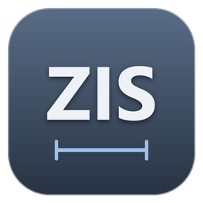
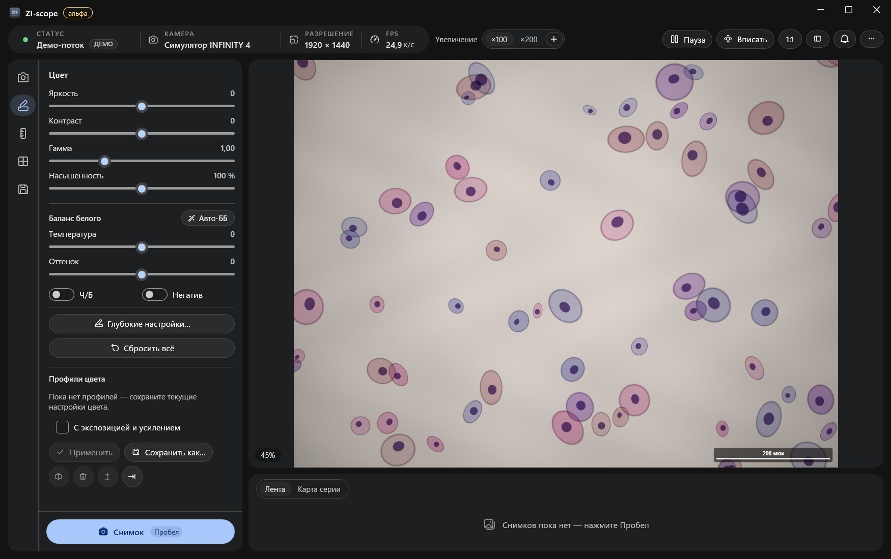

<p align="center">
  
</p>

<h1 align="center">ZI-scope</h1>

<p align="center">
  A Windows app for <b>Lumenera</b> microscope cameras: live view, colour, a micron scale bar, calibration from an image
  and series capture of slides with consistent file names.
</p>

<p align="center">
  <b>⚠️ Experimental alpha.</b> Expect bugs; double-check important images.
  <br>
  <a href="README.md">Русский</a>
</p>



> The user interface is in **Russian** only for now.

## What it is

ZI-scope replaces the stock camera software for day-to-day work at the microscope. It covers:
- live preview;
- colour correction;
- a micron scale bar;
- snapshots;
- guided series capture: it tells you which sample and magnification to shoot next and names the files for you.

It works fully offline. Without a camera, a **demo mode** simulates a slide so you can try everything.

## Features

- **Live preview:** zoom/pan, pause, histogram and focus assist.
- **Exposure and gain:** auto exposure, plus long exposures (the app lowers the frame rate by itself).
- **Colour:** basic sliders and auto white balance. A "deep" window adds levels, curves, 8-sector HSL, shadows/highlights, clarity, dehaze and sharpening.
- **Per-magnification profiles (×100, ×200, …):** colour, exposure, calibration and scale-bar length switch together.
- **Scale bar and length measurements in µm:** what you see in the preview is what gets saved.
- **Calibration:**
  - with a stage micrometer;
  - from an existing image with a scale bar (offline OCR);
  - by typing µm/px;
  - from a pixel-size table.
- **Image formats:** PNG, JPEG, TIFF, BMP and JPEG XR, optionally with a clean copy and JSON metadata.
- **Slide series** named `group_sample_magnification_kind` (`1_1_100_1`, `1_1_100_2`, …):
  - a series map;
  - skips and reshoots;
  - **extra frames** (e.g. `1_1_100_3`, another field of view on selected magnifications only);
  - a `.zisc` project file to resume a series later.
- **Profiles:** colour (`.zcolor`) and full configuration (`.zscope`).
- **One-click install** without admin rights; uninstall from *Settings → Apps*.

## Supported cameras

| | |
|---|---|
| **Tested** | **Lumenera INFINITY4-11** (USB 2.0, 4008 × 2672) |
| **Should work** | other Lumenera USB cameras that use the **LuCam** driver (`lucamapi.dll`): **INFINITY 1, 2, 3, 4, 5, 8** series and Lumenera **Lt / Lw / Lm** industrial cameras. Untested. |
| **Not tested** | monochrome models, 16-bit output (switched to 8-bit), multiple cameras at once (the first one is used) |
| **Not supported** | cameras without the LuCam driver |

Tried it with another Lumenera model? Please report the model and the result in [Issues](../../issues).

## Requirements

- Windows 10 (2004 or newer) or Windows 11, 64-bit.
- The **Lumenera driver**, from the free *INFINITY ANALYZE / INFINITY CAPTURE* package by Teledyne Lumenera. Without it the app runs in demo mode.
- No .NET install needed: it ships inside `ZI-scope.exe`.

## Try it

1. Download `ZI-scope.exe` from [Releases](../../releases) and run it.
2. If SmartScreen appears, click **More info → Run anyway**. The exe is not signed yet.
3. Accept the offer to install, or just keep using the exe as is.
4. Click **"Демо-режим"** (demo mode) if no camera is connected.

## Build from source

You need the [.NET 8 SDK](https://dotnet.microsoft.com/download/dotnet/8.0) on Windows.

```powershell
dotnet build LumeneraViewer.sln -c Debug
dotnet test LumeneraViewer.sln
dotnet run --project src/LumeneraViewer
powershell -ExecutionPolicy Bypass -File .\publish.ps1 -NoDrivers   # single exe → dist\ZI-scope-public\
```

The Lumenera driver installer is proprietary. It is not part of this repository, and builds that embed it
(`publish.ps1` without `-NoDrivers`) must not be redistributed.

Architecture notes are in [CLAUDE.md](CLAUDE.md) (Russian). Design decisions are in [docs/adr/](docs/adr/).

## License

No license has been chosen yet. Until one is added, the code is visible but no usage rights are granted.

Lumenera, INFINITY, INFINITY ANALYZE and INFINITY CAPTURE are trademarks of Teledyne Lumenera.
ZI-scope is an independent project and is not affiliated with Teledyne Lumenera.
