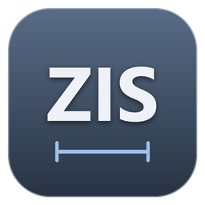
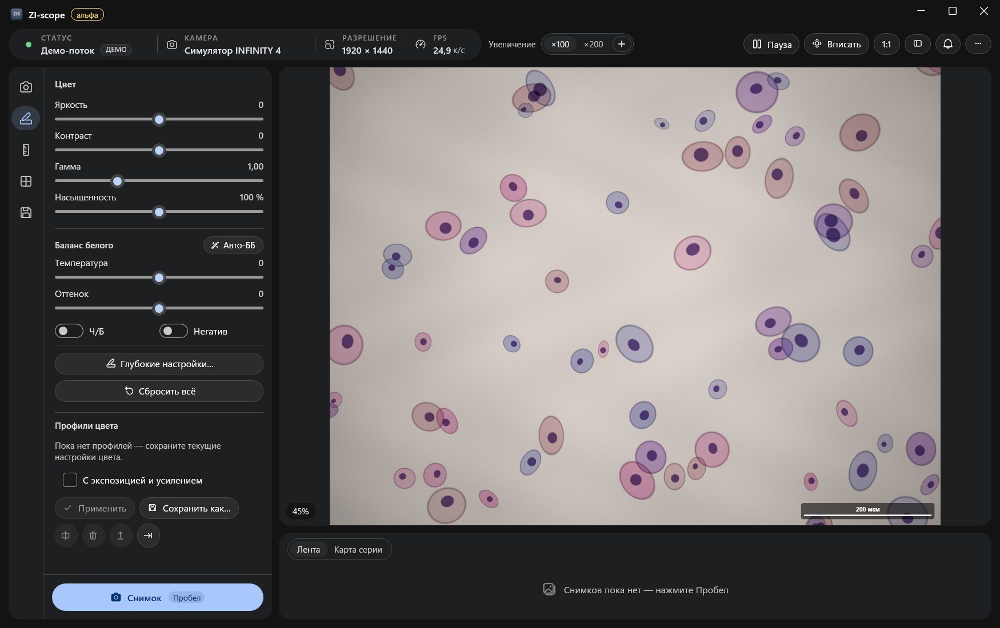
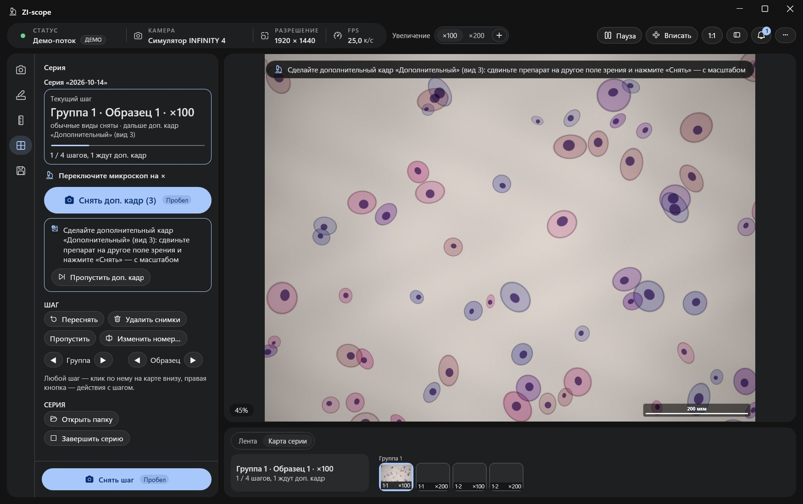

<p align="center">
  
</p>

<h1 align="center">ZI-scope</h1>

<p align="center">
  Программа для микроскопных камер <b>Lumenera</b> под Windows: живое изображение, цвет, масштаб в микронах,
  калибровка по снимку и съёмка серий препаратов с правильными именами файлов.
</p>

<p align="center">
  <b>⚠️ Экспериментальная альфа-версия.</b> Возможны ошибки; важные снимки проверяйте.
  <br>
  <a href="README.en.md">English</a>
</p>



## Что это

ZI-scope заменяет стандартную программу камеры для повседневной работы лаборанта за микроскопом.
Камера подключена по USB, а программа показывает живое изображение, правит цвет, рисует плашку масштаба
в микронах и сохраняет снимки. Ещё она ведёт съёмку серий: подсказывает, какой образец и на каком
увеличении снимать дальше, и сама называет файлы.

Интернет не нужен: программа не ходит в сеть. Без камеры работает **демо-режим** с имитацией препарата,
в нём можно попробовать всё.

## Возможности

- **Живое превью** с зумом и сдвигом, пауза, гистограмма, фокус-ассистент (оценка резкости).
- **Экспозиция и усиление**, автоэкспозиция, длинная выдержка (программа сама снижает частоту кадров).
- **Цвет:** яркость, контраст, гамма, насыщенность, баланс белого (в том числе авто).
  В окне «Глубокие настройки» есть уровни, кривые, HSL по 8 секторам, тени и света, чёткость, удаление дымки и резкость.
- **Увеличения ×100, ×200…** У каждого свои цвет, экспозиция, калибровка и длина плашки:
  переключили объектив, нажали ×200, и всё подстроилось.
- **Масштаб в микронах:** плашка (шрифт Arial, цвета, подложка, мкм или µm) и измерения длины прямо на кадре.
  В превью плашка выглядит так же, как в сохранённом файле.
- **Калибровка:**
  - по объект-микрометру;
  - по готовому снимку с плашкой: программа находит линию и читает число офлайн-OCR;
  - вводом мкм/px вручную;
  - по таблице пикселей.
- **Снимки** в PNG, JPEG, TIFF, BMP и JPEG XR. Можно сохранять копию без оверлея и JSON с метаданными.
- **Серии препаратов** по шаблону `группа_образец_увеличение_вид` (`1_1_100_1`, `1_1_100_2`…):
  - карта серии и пропуски;
  - пересъёмка и шаги вне плана;
  - **дополнительный кадр**: например, `1_1_100_3` с другим полем зрения, только на нужных увеличениях;
  - проект серии `.zisc` в папке серии, через «Открыть проект серии…» можно продолжить с того же шага.
- **Профили** цвета (`.zcolor`) и всей конфигурации (`.zscope`) для обмена между компьютерами.
- **Установка в один клик** без прав администратора, удаление через «Параметры → Приложения».



## С какими камерами работает

| | |
|---|---|
| **Проверено** | **Lumenera INFINITY4-11** (USB 2.0, 4008 × 2672): подключение, поток, экспозиция и усиление, автоэкспозиция, снимки во всех форматах |
| **Должно работать** | другие USB-камеры Lumenera с драйвером **LuCam**: серии **INFINITY 1, 2, 3, 4, 5, 8** и промышленные Lumenera **Lt, Lw, Lm**. Программа общается с камерой через стандартный `lucamapi.dll` и берёт размер кадра у самой камеры |
| **Не проверено** | монохромные модели, камеры с 16-битным выходом (программа переключает их в 8 бит), работа нескольких камер одновременно (берётся первая) |
| **Не поддерживается** | камеры без драйвера LuCam, например HDMI-модели и камеры других производителей |

Если у вас другая модель Lumenera и она заработала (или нет), напишите в
[Issues](../../issues) модель и что получилось: это лучший способ расширить список.

## Что нужно

- Windows 10 (версия 2004 или новее) или Windows 11, 64-бит.
- Для работы с камерой нужен **драйвер Lumenera**. Он входит в бесплатный пакет *INFINITY ANALYZE / INFINITY CAPTURE*
  с сайта Teledyne Lumenera. Без драйвера программа запустится в демо-режиме.
- .NET ставить не нужно: он уже внутри `ZI-scope.exe`.

## Как попробовать

1. Скачайте `ZI-scope.exe` со страницы [Releases](../../releases).
2. Запустите его. Если Windows покажет «Система Windows защитила ваш компьютер», нажмите **Подробнее → Выполнить
   в любом случае**: у программы пока нет цифровой подписи.
3. Программа предложит **установиться** на компьютер. Она скопирует себя в `%LocalAppData%\Programs\ZI-scope`
   и создаст ярлыки в «Пуске» и на рабочем столе. Можно отказаться: exe работает и без установки.
4. Нет камеры? Нажмите **«Демо-режим»**. Есть камера: поставьте драйвер Lumenera и подключите камеру по USB.
   Программа найдёт её сама.

### Первые шаги

- **Камера** (вкладка слева): экспозиция, усиление, автоэкспозиция.
- **Цвет:** базовые ползунки; всё остальное в «Глубоких настройках…».
- **Масштаб:** выберите увеличение в шапке (×100, ×200, «+» — своё) и откалибруйте его одним из способов.
  После этого на кадре появится плашка в микронах.
- **Снимок:** Пробел или большая кнопка внизу слева. Папка и формат задаются на вкладке «Сохранение».
- **Серия:** задайте группы, образцы, увеличения и виды кадра и нажмите «Начать серию».
  Дальше Пробел снимает текущий шаг, а программа подсказывает, что делать следующим.

### Что и где лежит

```
%AppData%\ZI-scope\settings.json      настройки (калибровки, профили увеличений, цвет)
%AppData%\ZI-scope\profiles\          профили конфигурации (.zscope)
<Изображения>\ZI-scope\               снимки по умолчанию

<папка серии>\
    Опыт 1.zisc                       проект серии: план, снятые шаги, метаданные всех кадров
    1_1_100_1.png                     группа 1, образец 1, ×100, вид 1 (без масштаба)
    1_1_100_2.png                     вид 2 (с плашкой масштаба)
    1_1_100_3.png                     доп. кадр (другое поле зрения)
    …
```

## Сборка из исходников

Нужен [.NET 8 SDK](https://dotnet.microsoft.com/download/dotnet/8.0) на Windows.

```powershell
dotnet build LumeneraViewer.sln -c Debug       # собрать
dotnet test LumeneraViewer.sln                 # тесты (xUnit)
dotnet run --project src/LumeneraViewer        # запустить (без камеры — «Демо-режим»)

# Один exe для раздачи (без драйверов Lumenera) → dist\ZI-scope-public\ZI-scope.exe
powershell -ExecutionPolicy Bypass -File .\publish.ps1 -NoDrivers
```

`publish.ps1` без `-NoDrivers` вшивает в exe установщик драйверов из `installer\infinity*.exe`.
Такой exe удобен для переноса на свой компьютер с микроскопом. Установщик Lumenera проприетарный: в репозиторий
он не входит, и **выкладывать такую сборку в открытый доступ нельзя**.

Устройство программы, соглашения и «как добавить свою функцию» описаны в [CLAUDE.md](CLAUDE.md).
Принятые решения и их причины — в [docs/adr/](docs/adr/).

```
src/LumeneraViewer/   приложение (WPF, .NET 8): Camera, Imaging, Overlays, Series, Export, Install, Views…
tests/                тесты xUnit
docs/adr/             архитектурные решения
tools/make_icon.py    генератор иконки
publish.ps1           сборка однофайлового exe
```

## Статус и обратная связь

Это **экспериментальная альфа**: программа проверена на одной камере (INFINITY4-11) и в демо-режиме.
На живой камере пока не проверены длинная выдержка со сменой частоты кадров и переподключение USB «на лету».
Ошибки и пожелания пишите в [Issues](../../issues).

## Лицензия

Лицензия пока не выбрана. До её появления код можно смотреть, но права на использование и изменение не предоставлены.

Lumenera, INFINITY, INFINITY ANALYZE и INFINITY CAPTURE — товарные знаки Teledyne Lumenera.
ZI-scope — независимый проект и с Teledyne Lumenera не связан.
